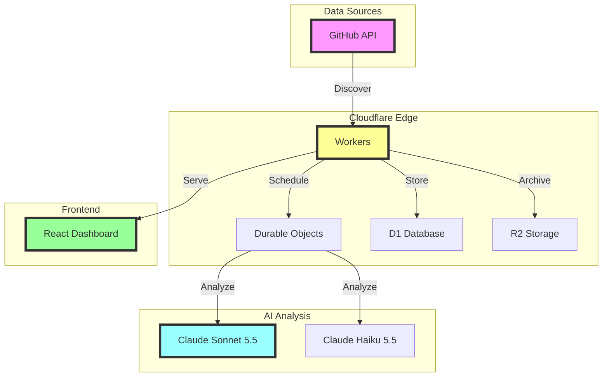

# 🚀 GitHub AI Intelligence Agent

<div align="center">
  
  [](https://github.com/nnkostov/cloudflare-agent-vibe-cline)
  [](LICENSE)
  [](https://workers.cloudflare.com)
  [](https://anthropic.com)
  
  **🤖 Your AI-Powered Venture Capital Analyst for GitHub**
  
  *Discover the next unicorn in AI/ML before everyone else does*

</div>

---

## 🎯 What is This?

Imagine having a tireless AI analyst that:
- 🔍 **Scans GitHub 24/7** for emerging AI/ML projects
- 🧠 **Analyzes with Claude AI** using VC-grade investment criteria
- 📊 **Tracks growth patterns** across thousands of repositories (about 4,500 today)
- 🚨 **Raises alerts** when an analysis finds a high-potential opportunity
- 🎨 **Visualizes insights** in a stunning cyberpunk dashboard

**This is that analyst.** Built on Cloudflare Workers, powered by Claude AI, and designed for serious investors.

## 🚀 Why This Matters

### The Problem We Solve

<table>
<tr>
<td width="50%">

#### ❌ **Without This System**
- **40+ hours/week** of manual research
- **Miss 90%** of emerging projects
- **Subjective** gut-feeling decisions
- **$200K+/year** for analyst teams
- **Delayed discovery** (weeks behind)
- **Limited coverage** (human constraints)

</td>
<td width="50%">

#### ✅ **With This System**
- **24/7 automated** monitoring
- **Thousands of AI/ML repos** tracked continuously
- **Data-driven** AI analysis
- **~$100–150/month** in Claude usage
- **Real-time discovery** (within hours)
- **Unlimited scalability** (no human limits)

</td>
</tr>
</table>

### 💰 Real Cost Comparison

- **Human Analyst Team**: $200,000-500,000/year
- **This System**: roughly $100–150/month of Claude usage at current volume, plus Cloudflare's $5/month Workers Paid plan
- **ROI**: Find just ONE good investment and it pays for itself 1000x over

### ⏱️ Time Savings

- **Manual Research**: 40+ hours per week
- **With Our System**: 5 minutes to review curated results
- **That's 99% time saved** for strategic thinking instead of data gathering

## ✨ Features That Make Us Special

<table>
<tr>
<td width="50%">

### 🧠 **AI-Powered Analysis**
- **Claude Sonnet 5.5** for full investment analysis of repos scoring 50+
- **Claude Haiku 5.5** for efficient quick scans of the long tail
- Structured outputs: every analysis is schema-valid JSON
- Multi-factor scoring algorithm

</td>
<td width="50%">

### ⚡ **Real-Time Intelligence**
- Hourly GitHub discovery scans
- Analysis batches every 30 minutes
- Smart tier-based prioritization
- Re-analysis only when a repository changes

</td>
</tr>
<tr>
<td width="50%">

### 🎮 **Cyberpunk Dashboard**
- Neural Activity Command Center
- Investment opportunity scoring
- Community health metrics
- Real-time system monitoring

</td>
<td width="50%">

### 📈 **Investment Insights**
- Growth trajectory predictions
- Technical moat assessment
- Team strength evaluation
- Market opportunity analysis

</td>
</tr>
</table>

## 🏗️ Architecture




## 🎯 How It Works

### 🔍 Repository Discovery Process

Every hour the agent searches GitHub with seven strategies:

1. **Established projects**: `topic:ai` or `topic:llm` with 500+ stars
2. **New projects**: created in the last 30 days with `topic:ai` or `topic:llm` and 5+ stars
3. **Trending projects**: pushed in the last 7 days with `topic:ai` or `topic:machine-learning` (20+ stars), or Python projects with `topic:ai` (10+ stars)

New repositories are saved and assigned a tier; forks and archived repositories are excluded from analysis. Known repositories are refreshed as they show up again.

Each tier is then refreshed from GitHub on its own schedule (below). Every successful refresh records the repository's real star count for the day, so growth is measured from actual history.

### 📊 Three-Tier Analysis System

```
┌─────────────────────────────────────────────────────────────┐
│ 🏆 TIER 1: PREMIUM ANALYSIS                                 │
├─────────────────────────────────────────────────────────────┤
│ ⭐ High-growth repositories with exceptional potential      │
│ 🤖 Re-analyzed when it changes, at least every 7 days      │
│ ⏰ Deep-scanned every 6 hours                               │
│ 📈 Includes technical moat & scalability assessment        │
└─────────────────────────────────────────────────────────────┘

┌─────────────────────────────────────────────────────────────┐
│ 🥈 TIER 2: STANDARD ANALYSIS                                │
├─────────────────────────────────────────────────────────────┤
│ ⭐ Established projects with steady growth                  │
│ 🤖 Re-analyzed when it changes, at least every 14 days     │
│ ⏰ Scanned every 12 hours                                   │
│ 📊 Full investment scoring and recommendations             │
└─────────────────────────────────────────────────────────────┘

┌─────────────────────────────────────────────────────────────┐
│ 🥉 TIER 3: DISCOVERY SCAN                                   │
├─────────────────────────────────────────────────────────────┤
│ ⭐ Emerging projects and hidden gems                       │
│ 🤖 Re-analyzed when it changes, at least every 30 days     │
│ ⏰ Scanned every 2 days for breakout potential              │
│ 🔍 Efficient scanning to catch rising stars early         │
└─────────────────────────────────────────────────────────────┘
```

## 🔬 What We Analyze

### 📊 Repository Data Collection

<table>
<tr>
<td width="33%">

**📈 Growth (all tiers)**
- Daily star snapshots
- Star velocity (stars/day)
- Fork counts
- Open issues

</td>
<td width="33%">

**🏃 Activity (Tier 1 deep scan)**
- Commits and unique authors per day (30 days)
- Releases
- Pull requests: volume, merge time, contributors
- Issues: close rate, time to first response
- Active forks

</td>
<td width="33%">

**👥 Team (high scorers)**
- Top contributors' profiles (company, location, followers) for repos scoring 70+ on investment

</td>
</tr>
</table>

### 🤖 AI-Powered Investment Analysis

Claude returns a structured analysis (validated against a JSON schema) for each repository. An illustrative example:

```
┌─────────────────────────────────────────────────────────────┐
│ 📊 INVESTMENT SCORECARD                    (scores 0–100)   │
├─────────────────────────────────────────────────────────────┤
│ Investment        78     Technical moat       52            │
│ Innovation        76     Scalability          82            │
│ Team              80     Developer adoption   96            │
│ Market            88                                        │
│                                                             │
│ Recommendation: BUY   (strong-buy · buy · watch · pass)     │
│                                                             │
│ 💪 Strengths      ⚠️  Risks      ❓ Due-diligence questions  │
│ 📈 Growth prediction (6–12 months)                          │
│ 💡 Investment thesis (for buy / strong-buy)                 │
│ 🥊 Competitive analysis                                     │
└─────────────────────────────────────────────────────────────┘
```

Scores of 80+ on investment raise an investment-opportunity alert (90+ is urgent).

### 📋 Complete Analysis Output

Each analysis on the dashboard's Analysis page includes:

1. **Scores**: investment, innovation, team, market, technical moat, scalability and developer adoption (0–100)
2. **Recommendation**: strong-buy, buy, watch or pass
3. **Executive summary**: 3–4 paragraphs
4. **Strengths and risks**
5. **Due-diligence questions**
6. **Growth prediction** for the next 6–12 months
7. **Investment thesis** when the recommendation is buy or strong-buy
8. **Competitive analysis**

Model and cost: repositories scoring 50+ on the agent's own score are analyzed by Claude Sonnet 5.5 (about $0.03 each), the rest by Claude Haiku 5.5 (about $0.002). Every analysis records its real token usage and cost.

## 🎮 Dashboard Preview

<div align="center">

### 🌟 Neural Activity Command Center
*Real-time system monitoring with cyberpunk aesthetics*

```
╔═══════════════════════════════════════════════════════════╗
║          🧠 NEURAL ACTIVITY COMMAND CENTER 🧠             ║
╠═══════════════════════════════════════════════════════════╣
║                                                           ║
║  ┌─────────────┐  ┌─────────────┐  ┌─────────────┐      ║
║  │ API NEXUS   │  │ ANALYSIS    │  │ QUEUE       │      ║
║  │ ████████░░  │  │ CORE        │  │ MATRIX      │      ║
║  │ 87% Active  │  │ ██████████  │  │ ████░░░░░░  │      ║
║  │             │  │ Processing  │  │ 42 Pending  │      ║
║  └─────────────┘  └─────────────┘  └─────────────┘      ║
║                                                           ║
╚═══════════════════════════════════════════════════════════╝
```

</div>

## 📡 API Endpoints

### Core Operations

| Endpoint | Method | Description |
|----------|--------|-------------|
| `/api/status` | GET | System health and metrics |
| `/api/version` | GET | Deployed version, version id and upload time |
| `/api/scan` | POST | Trigger manual repository scan |
| `/api/analyze` | POST | Analyze a repository (`{repoOwner, repoName, force}`) |
| `/api/analyze/:owner/:repo` | GET | Latest analysis for a repository (analyzes it if missing) |
| `/api/batch/history` | GET | Recent scheduled analysis batches |

### Data Access

| Endpoint | Method | Description |
|----------|--------|-------------|
| `/api/repos/trending` | GET | Get trending repositories |
| `/api/repos/tier` | GET | Get repositories by tier |
| `/api/repos/count` | GET | Get repository statistics |
| `/api/metrics/comprehensive` | GET | Detailed repository metrics |

### Intelligence Reports

| Endpoint | Method | Description |
|----------|--------|-------------|
| `/api/reports/daily` | GET | Daily investment summary |
| `/api/reports/enhanced` | GET | Deep analysis reports |
| `/api/alerts` | GET | Investment-opportunity and system alerts |
| `/api/worker-metrics` | GET | Activity over the last hour in 5-minute buckets |

## 🎯 Use Cases

### 🏦 For Venture Capitalists
> "Find the next AI unicorn before it hits mainstream"
- Automated deal flow for AI/ML investments
- Early detection of high-growth projects
- Comprehensive technical due diligence

### 💎 For Angel Investors
> "Discover early-stage AI gems before VCs do"
- Identify promising projects at seed stage
- Track founder activity and team growth
- Get in before valuations skyrocket

## 🛠️ Advanced Configuration

<details>
<summary><b>🔧 Secrets and configuration</b></summary>

The Worker needs two secrets:

```bash
GITHUB_TOKEN=            # GitHub personal access token
ANTHROPIC_API_KEY=       # Anthropic API key
```

Set them with `wrangler secret put` for production, and in `.dev.vars` for local development (see `.env.example`).

Everything else (models, effort levels, pricing, score thresholds, tier settings) lives in `CONFIG` in `src/types/index.ts`; schedules are the cron triggers in `wrangler.toml`.

</details>

<details>
<summary><b>📊 Scoring Algorithm</b></summary>

Before calling Claude, the agent scores each repository from its GitHub data:

```typescript
Total Score = (Growth × 0.4) + (Engagement × 0.3) + (Quality × 0.3)

Where:
- Growth: star count, fork-to-star ratio, fork count
- Engagement: fork and issue ratios, AI/ML topic relevance
- Quality: description, topics, language, recent updates, not archived or a fork
```

The score picks the Claude model (50+ gets Sonnet, below 50 Haiku). Tiers are assigned separately, from stars and real growth velocity.

</details>

<details>
<summary><b>🚀 Performance and cost controls</b></summary>

- **Change-driven re-analysis**: a repository is re-analyzed only after it changes (new pushes, or stars or forks up 10%+), or when it reaches its tier's maximum age (7, 14 or 30 days)
- **Rate limiting**: GitHub calls at 30/minute, Claude calls at 30/minute
- **Run locks**: a scan or batch that outlasts its cron slot is never started twice
- **Structured outputs**: no failed or retried analyses from malformed JSON
- **Edge computing**: runs on Cloudflare Workers, Durable Objects, D1 and R2

</details>

## 📈 Success Metrics

### 🏆 What Makes This Powerful

- **⚡ Speed**: From discovery to analysis in minutes, not days
- **🎯 Accuracy**: VC-grade analysis powered by Claude AI
- **📊 Coverage**: Comprehensive monitoring of the AI/ML ecosystem
- **🔄 Automation**: 24/7 operation without human intervention

### 💡 Real Impact

- **Time Saved**: Replaces hours of manual research
- **Opportunities Found**: Discovers projects before they trend
- **Insights Generated**: Deep technical and business analysis
- **Decisions Enabled**: Data-driven investment recommendations

## 📚 Documentation

- [CLAUDE.md](CLAUDE.md): architecture, commands, model selection, re-analysis policy and D1 gotchas (kept current)
- [docs/archive/](docs/archive/): historical implementation and fix notes (2025–early 2026; may describe code that has since changed)

## 🎉 Fun Facts

<div align="center">

### Did You Know? 🤔

- Our AI analyzes repositories faster than you can say "venture capital"
- The cyberpunk dashboard was inspired by Blade Runner and The Matrix
- We've discovered several projects that later became GitHub trending
- The system runs 24/7 and never needs coffee ☕

</div>

## 🚀 Quick Start

### Prerequisites
- Node.js 22+ (required by Wrangler 4)
- Cloudflare account on the Workers Paid plan (Durable Objects, D1, R2)
- GitHub personal access token
- Anthropic API key

### 1️⃣ Clone & Install

```bash
git clone https://github.com/nnkostov/cloudflare-agent-vibe-cline.git
cd cloudflare-agent-vibe-cline

npm install
cd dashboard && npm install && cd ..
```

### 2️⃣ Local Secrets

```bash
# Wrangler reads local secrets from .dev.vars (gitignored)
cp .env.example .dev.vars
# then fill in GITHUB_TOKEN and ANTHROPIC_API_KEY
```

### 3️⃣ Set Up Cloudflare Resources

```bash
npx wrangler d1 create github-intelligence
npx wrangler r2 bucket create github-analyses

# Put the new D1 database_id into wrangler.toml and wrangler.tail.toml
```

### 4️⃣ Initialize the Database

```bash
npx wrangler d1 execute github-intelligence --remote --file=database/schemas/schema-canonical.sql
```

Later schema changes ship as files in `database/migrations/`; run each with the same command, before deploying the code that needs it.

### 5️⃣ Deploy

```bash
npx wrangler secret put GITHUB_TOKEN
npx wrangler secret put ANTHROPIC_API_KEY

# Builds the dashboard, deploys the Worker, and commits + tags a version bump
npm run deploy

# Deploy the log-collecting tail Worker
npx wrangler deploy -c wrangler.tail.toml
```

### 6️⃣ Scheduling

Everything runs from the cron triggers in `wrangler.toml`; there is nothing to initialize. Discovery scans run hourly, analysis batches every 30 minutes, and a full sweep runs at 02:00 and 14:00 UTC.

## 📜 License

MIT License - see [LICENSE](LICENSE) for details

---

<div align="center">

**Built with ❤️ by developers who believe AI should work for us**

[🌐 Live Demo](https://github-ai-intelligence.nkostov.workers.dev)

</div>
